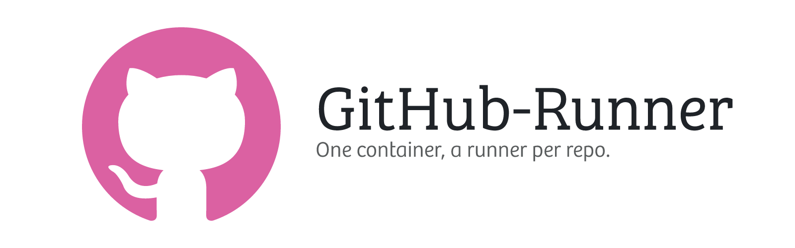
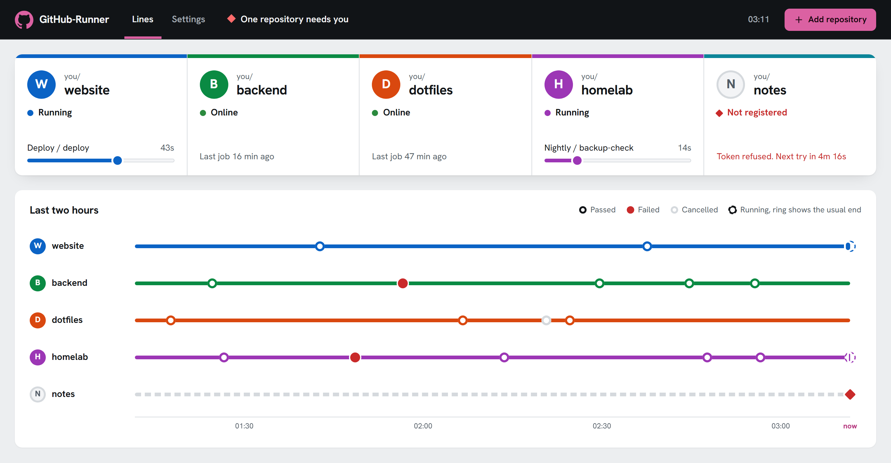
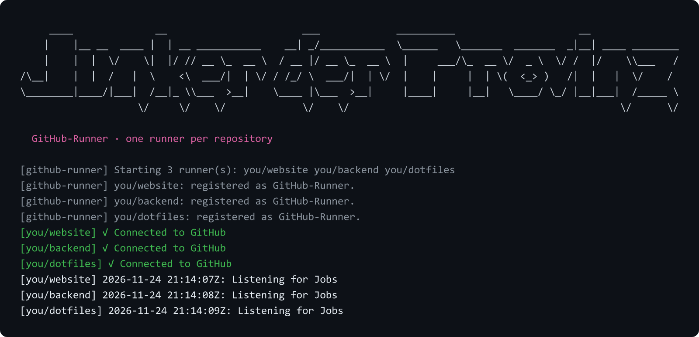

<picture>
  <source media="(prefers-color-scheme: dark)" srcset=".github/assets/banner-dark.png">
  
</picture>

<p align="center">
  <a href="https://github.com/junkerderprovinz/github-runner/actions/workflows/build.yml"></a>&nbsp;
  <a href="https://github.com/myoung34/docker-github-actions-runner"></a>&nbsp;
  <a href="https://ca.unraid.net/apps?q=github-runner"></a>&nbsp;
  <a href="LICENSE"></a>
</p>

<p align="center">
Self-hosted <b>GitHub Actions runners</b> for several repositories in <b>one container</b>.
A personal GitHub account can attach a runner to a single repository only, so the
usual images need one container per repository. This one starts a runner for every
repository you add, shows them all in a web interface, and removes them from GitHub
again when it stops.
</p>

<br>

<p><a id="table-of-contents" href="#table-of-contents"><picture><source media="(prefers-color-scheme: dark)" srcset=".github/assets/sections/table-of-contents-dark.svg"></picture></a></p>

1. [Download](#1-download)
2. [Support](#2-support)
3. [What it looks like](#3-what-it-looks-like)
4. [What it does](#4-what-it-does)
5. [Getting started](#5-getting-started)
6. [How AI is used here](#6-how-ai-is-used-here)

<br>

<p><a id="1-download" href="#1-download"><picture><source media="(prefers-color-scheme: dark)" srcset=".github/assets/sections/1-download-dark.svg"></picture></a></p>

<!-- download-buttons: written by scripts/gen_download_buttons.py -->
<p align="center">
  <picture><source media="(prefers-color-scheme: dark)" srcset=".github/assets/sections/group-server-dark.svg"></picture>
</p>
<p align="center">
  &nbsp;<a href="https://ca.unraid.net/apps?q=github-runner"></a>&nbsp;
  &nbsp;<a href="https://mos-official.net/apps.html?search=GitHub-Runner"></a>&nbsp;
  &nbsp;<a href="https://github.com/junkerderprovinz/zimaos-apps#install"></a>&nbsp;
  &nbsp;<a href="https://github.com/junkerderprovinz/umbrel-apps#install"></a>&nbsp;
  <br>
  &nbsp;<a href="https://github.com/junkerderprovinz/truenas-apps#github-runner"></a>&nbsp;
  &nbsp;<a href="#synology"></a>&nbsp;
  &nbsp;<a href="#qnap"></a>&nbsp;
  &nbsp;<a href="#ugreen"></a>&nbsp;
  <br>
  &nbsp;<a href="https://raw.githubusercontent.com/junkerderprovinz/github-runner/main/compose.yaml"></a>&nbsp;
  &nbsp;<a href="https://github.com/junkerderprovinz/github-runner/releases/latest"></a>&nbsp;
</p>
<!-- /download-buttons -->

<br>

<p><a id="2-support" href="#2-support"><picture><source media="(prefers-color-scheme: dark)" srcset=".github/assets/sections/2-support-dark.svg"></picture></a></p>

<p align="center">
A one-knight job: I build it, keep it running, work through the issues and add what people ask for, until nothing is missing. It is free, with no accounts, no telemetry, no ads and no paid tier. No asterisk anywhere. Nothing readable ever leaves your own walls. Forged on evenings and weekends, with heart and stubbornness.
</p>

<p align="center">
If it has earned a place on your server or computer, toss a coin to your knight: it helps cover the costs and keeps the project alive. It also makes this knight's heart beat a little faster. Three ways below, whichever suits you.
</p>

<!-- give-buttons: written by scripts/gen_download_buttons.py -->
<p align="center">
  &nbsp;<a href="https://buymeacoffee.com/junkerderprovinz"></a>&nbsp;
  &nbsp;<a href="https://www.paypal.com/donate/?hosted_button_id=76FVV52TKXTUS"></a>&nbsp;
  &nbsp;<a href="https://junkerderprovinz.github.io/junkerderprovinz/"></a>&nbsp;
</p>
<!-- /give-buttons -->

<br>

<p><a id="3-what-it-looks-like" href="#3-what-it-looks-like"><picture><source media="(prefers-color-scheme: dark)" srcset=".github/assets/sections/3-what-it-looks-like-dark.svg"></picture></a></p>

The repository names in these pictures are made up.

<p align="center">
  
  <br><em>The web interface: two runners at work, two waiting, and one repository the token may not manage</em>
</p>

<p align="center">
  
  <br><em>The log after a start with three repositories: each one gets its own runner, all listening for jobs</em>
</p>

<br>

<p><a id="4-what-it-does" href="#4-what-it-does"><picture><source media="(prefers-color-scheme: dark)" srcset=".github/assets/sections/4-what-it-does-dark.svg"></picture></a></p>

- **One container, many repositories.** Add them in the web interface and each one gets its own runner. On a personal account that is the only way to share a machine between repositories, short of moving them into an organization.
- **A web interface.** Port 8080 shows every repository as a line: waiting for jobs, running one, restarting or refused. The jobs of the last two hours sit on it as stops, and each repository has its live log and the jobs of the last two days. You add or remove repositories there, restart a runner, replace the token or change the labels, and the container keeps running.
- **Clean up on stop.** Stopping the container removes every runner from GitHub, so the Actions settings of your repositories never fill up with offline leftovers. Starting it registers them again.
- **One bad entry does not stop the rest.** A repository the token cannot reach is reported in the log and the web interface, with the answer GitHub gave (401, 403 or 404), and tried again every five minutes, while the others keep running.
- **Clear messages.** A missing token or an empty list keeps the container waiting with one line in the log that says what is missing. Fill it in on the web interface.
- **A password if you want one.** Nothing is locked until you set a password in the settings. After that the page asks for it, and each wrong try in a row is answered a little later, up to ten seconds, while the right password always gets through.
- **Docker in your jobs.** Mount the Docker socket and the runners can build images and start containers, as in GitHub's own runners.
- **Root or not.** The runners run as root by default, like the upstream image. With `RUN_AS_ROOT=false` they run as the unprivileged `runner` user.
- **Healthy means listening.** The health check turns red as soon as one of the listed repositories has no runner waiting for jobs.
- **Built on [myoung34/github-runner](https://github.com/myoung34/docker-github-actions-runner).** The runner, its tools and its updates come from there. This image adds the service that runs several of them and the web interface.

<br>

<p><a id="5-getting-started" href="#5-getting-started"><picture><source media="(prefers-color-scheme: dark)" srcset=".github/assets/sections/5-getting-started-dark.svg"></picture></a></p>

You need a personal access token that may manage runners in every repository you list:

- **Fine-grained token:** repository access to those repositories, permission **Administration: Read and write**.
- **Classic token:** the `repo` scope.

On Unraid, install GitHub-Runner from [Community Applications](https://ca.unraid.net/apps?q=github-runner) and open its WebUI. Anywhere else, one container is enough:

```sh
docker run -d --name github-runner \
  -p 8080:8080 \
  -v /srv/github-runner:/config \
  -v /var/run/docker.sock:/var/run/docker.sock \
  --stop-timeout 60 \
  junkerderprovinz/github-runner:latest
```

Open `http://your-server:8080`, paste the token under **Settings** and add your repositories. Then point a workflow at them with `runs-on: self-hosted`. Each runner shows up under **Settings → Actions → Runners** of its repository, named `GitHub-Runner`.

The settings live in `/config/config.json`, next to the job history. On the very first start the variables below fill that file, so an install from before the web interface keeps its token and repositories. After that the web interface is where you change them, and the variables are only read again in two cases. A new `ACCESS_TOKEN` in the container settings replaces the saved token at the next start, and a token you replaced in the web interface stays until that variable changes again. Repositories that are new in `RUNNER_REPOS` are added at the next start, while one you take out of the list keeps its runner until you remove it in the web interface. Changing any other variable later does nothing, and the log says so.

| Variable | Default | What it does |
| --- | --- | --- |
| `ACCESS_TOKEN` | | Personal access token, see above. You can paste it in the web interface instead. |
| `RUNNER_REPOS` | | Repositories as `owner/name`, separated by spaces or commas. New entries are added at the next start. |
| `REPO_OWNER` | | Owner for entries written without one, so `RUNNER_REPOS=website backend` works. |
| `RUNNER_NAME` | `GitHub-Runner` | Name of the runner in every repository. |
| `LABELS` | `self-hosted` | Extra labels, comma-separated. |
| `NO_DEFAULT_LABELS` | `false` | `true` drops GitHub's default labels `self-hosted`, `Linux` and `X64`. |
| `RUN_AS_ROOT` | `true` | `false` runs the runners as the `runner` user. |
| `DEREGISTER_ON_STOP` | `true` | `false` keeps the runners registered while the container is stopped. |
| `RETRY_SECONDS` | `300` | How long to wait before trying a repository again that failed. |
| `WEBUI_PORT` | `8080` | Port of the web interface inside the container. |

Give the container a minute to stop (`--stop-timeout 60`, already set in the Unraid template). Removing the runners takes a moment per repository, and Docker's default of ten seconds can cut that short with many of them.

A self-hosted runner runs whatever the workflow in that repository tells it to. Use it for your own repositories, not for public ones where strangers can open pull requests.

The web interface has no password until you set one under **Settings → Security**, so anyone who can reach port 8080 can use it, under any address. Keep the port inside your home network, or set a password before you put it behind a reverse proxy with a public domain. Only a hash of the password is stored, and the token never leaves the container: the page shows its last four characters and nothing more.

Forgot the password? Click **Forgot password?** on the sign-in page. GitHub-Runner writes a code to its container log (on Unraid: Docker tab, the GitHub-Runner icon, **Logs**) that is valid for 10 minutes. Type it in with a new password, and every other session ends. Anyone who can read the container log can reset the password this way: root on the server, a log viewer such as Dozzle, any container with the Docker socket (read-only is enough) and any tool that forwards container logs.

### Other Docker hosts

[compose.yaml](compose.yaml) runs GitHub-Runner on any Linux server with Docker. Put it in a folder of its own, fill in the token and the repositories, and start it with `docker compose up -d`.

- **Synology:** see [Synology](#synology) below.
- **QNAP:** see [QNAP](#qnap) below.
- **UGREEN:** see [UGREEN](#ugreen) below.
- **Proxmox:** run it in a VM or an LXC container that has Docker.
- **MOS:** install GitHub-Runner from the [MOS Hub](https://mos-official.net/apps.html?search=GitHub-Runner).
- **ZimaOS and CasaOS:** add the [community store](https://github.com/junkerderprovinz/zimaos-apps#install) and install GitHub-Runner from it.
- **umbrelOS:** add the [community app store](https://github.com/junkerderprovinz/umbrel-apps#install) and install GitHub-Runner from it.

### Synology

In Container Manager (DSM 7.2 or newer), open **Project** and click **Create**. Pick a folder for GitHub-Runner and upload [compose.yaml](compose.yaml). Container Manager does not create missing folders, so create the ones the file names under `volumes` in File Station first.

### QNAP

In Container Station, open **Applications** and click **Create**. Paste [compose.yaml](compose.yaml) and point the folders under `volumes` at a share, for example `/share/Container/github-runner`.

### UGREEN

In the Docker app of UGOS Pro, open **Project** and click **Create**. Pick a folder for GitHub-Runner and paste [compose.yaml](compose.yaml).

<sub>The Synology logo is a trademark of Synology Inc. and the QNAP logo a trademark of QNAP Systems, Inc., both registered in Taiwan and other regions.</sub>

<br>

<p><a id="6-how-ai-is-used-here" href="#6-how-ai-is-used-here"><picture><source media="(prefers-color-scheme: dark)" srcset=".github/assets/sections/6-how-ai-is-used-here-dark.svg"></picture></a></p>

One knight builds this, and AI is one of the tools I work with, the same way I work with an editor or a compiler. It helps me write code and documentation and it checks my work, and that saves me a good many evenings. It does not make the decisions, though. I read and understand everything before it ships, and if something here breaks, that is on me and not on the tool.

You do not have to take my word for it. The code is open and every release note is written by hand. The issue tracker shows how problems actually get handled, including the ones I got wrong the first time. If you find something that is not right, open an issue and I will look at it.

<br>

Questions, bugs, ideas or feature requests? Please [open a GitHub issue](https://github.com/junkerderprovinz/github-runner/issues).

<sub>The runner image is made by myoung34 and the GitHub Actions runner by GitHub. Both ship here unmodified. GitHub and the Octocat are trademarks of GitHub, Inc. This project is not affiliated with GitHub.</sub>
